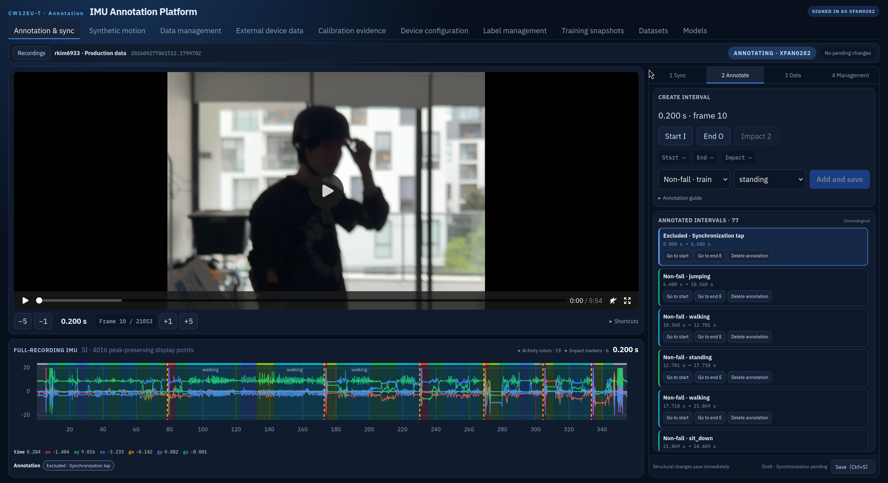

# IMU Data Collector

Capture, synchronize, annotate, and export IMU and video datasets.

IMU Data Collector combines a local BLE sensor and camera recorder with a web
annotation platform. It preserves raw measurements and timestamps, pairs video
with sensor traces, and produces reproducible HDF5 datasets for activity
recognition and fall-detection research.

[Documentation](docs/README.md) · [Getting started](docs/getting-started.md) ·
[Self-hosting](docs/self-hosting.md) · [Releases](https://github.com/Kscii/imu-data-collector/releases)



*Review video, label activity intervals, and inspect six-axis IMU data in one workspace.*

## Features

- **Local recording:** BLE IMU and camera capture with raw packets, timestamps,
  device configuration, and recording diagnostics preserved in HDF5 and MKV.
- **Video-assisted annotation:** synchronization anchors, precise interval
  boundaries, fall events, exclusions, and a shared video/IMU cursor.
- **Collaborative review:** task ownership, versioned activity labels, data
  management, and explicit completion checks.
- **Dataset export:** immutable 25 Hz training snapshots and a separate HDF5
  delivery format with embedded video.
- **Optional integrations:** synthetic-motion review, external device history,
  calibration experiments, and dataset/model catalogs.

## Hosted platform

The hosted instance at [imu.kscii.tech](https://imu.kscii.tech/) is restricted to
allowlisted users. It is not an open registration service.

To run your own instance, follow the [self-hosting guide](docs/self-hosting.md)
or the dedicated [GCP deployment guide](docs/gcp-deployment.md).

## Quick start

For native Linux, install Python 3.12, [uv](https://docs.astral.sh/uv/), Node.js 24,
FFmpeg/FFprobe, BlueZ, and v4l-utils. See
[Getting started](docs/getting-started.md) for prerequisites and configuration.

```bash
git clone https://github.com/Kscii/imu-data-collector.git
cd imu-data-collector
uv sync --frozen
npm ci --prefix frontend
npm run build:capture --prefix frontend
uv run --frozen imu-collector doctor
uv run --frozen imu-collector start
```

The capture app opens at `http://127.0.0.1:8765`. Source installs store recordings
locally by default; cloud publishing requires your own configuration. Select a
supported device explicitly before recording.

The annotation app can also run locally without a connected sensor or camera:
see [Local annotation](docs/self-hosting.md#local-annotation).

Windows and macOS preview installers are available on the
[Releases page](https://github.com/Kscii/imu-data-collector/releases).
Check [platform support](docs/desktop-platforms.md) before choosing a build.
The web interface supports English and Chinese; this repository's documentation
is maintained in English.

## Documentation

| Task | Guide |
| --- | --- |
| Install and make a recording | [Getting started](docs/getting-started.md) · [Capture](docs/capture-guide.md) |
| Synchronize and annotate | [Annotation guide](docs/annotation-and-sync.md) |
| Add or calibrate a sensor | [Device integration](docs/device-registry-and-protocols.md) · [Calibration](docs/calibration-experiments.md) |
| Understand stored data | [Data formats](docs/data-format.md) · [Data pipeline](docs/data-pipeline.md) |
| Host a private platform | [Self-hosting](docs/self-hosting.md) · [GCP deployment](docs/gcp-deployment.md) |
| Explore other modules | [Documentation index](docs/README.md) |

## Contributing

See [CONTRIBUTING.md](CONTRIBUTING.md) for development setup and checks.
Report bugs or propose improvements through
[GitHub Issues](https://github.com/Kscii/imu-data-collector/issues).
Report security issues privately using [SECURITY.md](SECURITY.md).

## License

[MIT](LICENSE). Bundled third-party software retains its own licenses; see
[THIRD_PARTY_NOTICES.md](THIRD_PARTY_NOTICES.md).
Participant recordings and datasets are not licensed by the software license.
