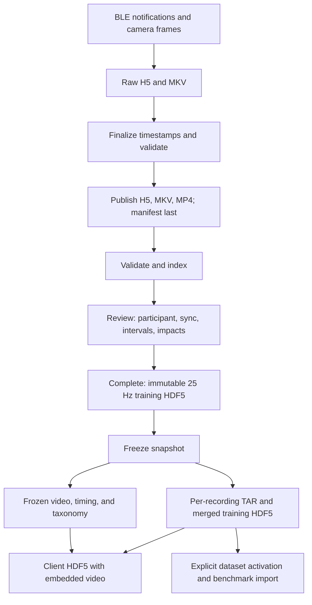

# Data pipeline

This guide follows a recording through storage and export. For field definitions,
units, versions, and readers reusable by other projects, use [Data formats](data-format.md).

## Flow



Raw capture retains actual timestamps. A completed annotation's per-recording H5
already uses training schema 3.2; snapshot packaging and merging do not resample it.

## Persisted stages

| Stage | Artifacts | Meaning |
| --- | --- | --- |
| Preview | Memory-only sensor/camera state | No recording files |
| Recording | `.partial.h5`, `.partial.mkv` | Mutable in-progress or interrupted evidence |
| Finalization | `.finalizing.h5`, `.finalizing.mkv` | Durable inputs for background processing |
| Local ready | Matching `.h5`, `.mkv` | Raw counts/bytes, actual times, finalized video |
| Publication | `capture.h5`, `video.mkv`, `preview.mp4`, `manifest.json` | Immutable verified object set, manifest last |
| Indexing | SQLite catalog and `index-receipts/<recording_id>.json` | Discovery/acceptance separate from upload |
| Review | `reviews/<recording_id>/review.json` | Current participant/sync/annotation/owner/revision |
| Completion | `exports/<recording_id>/review-<revision>/aligned-<digest>.h5` | Immutable training export; review points to current version |
| Snapshot | TAR, merged H5, frozen video/view/taxonomy references | Stable selection and provenance |
| Client delivery | Video-enabled H5 plus manifest/job status | Derived from one immutable snapshot |

`review.json` and explicit current pointers are mutable under concurrency controls.
Raw files, exported data, snapshot payloads, and their manifests are immutable.

## Object families

```text
captures/<recording_id>/
reviews/<recording_id>/review.json
exports/<recording_id>/review-<revision>/
training-snapshots/<snapshot_id>/
benchmark-datasets/team/cw12eu/<snapshot_id>/datasets/cw12eu.h5
benchmark-datasets/team/cw12eu/<snapshot_id>/manifest.json
benchmark-datasets/team/cw12eu/current.json
client-deliveries/<snapshot_id>/hdf5-v1/
calibration-evidence/<profile_id>/<recording_id>/
index-receipts/<recording_id>.json
```

Paths are object-store keys relative to the configured root/bucket. Consumers should
follow validated manifest descriptors instead of reconstructing every path themselves.
Optional synthetic/external integrations use separate prefixes and contracts.

## What changes at each boundary

Finalization reconstructs protocol-specific sample timing, preserves frame PTS,
remuxes the MKV to a browser timeline, and records quality results. Publication adds
a rebuildable MP4 and verified descriptors. The annotation server discovers only
complete valid manifests.

Synchronization and labeling update the review, not the source H5/MKV. Completion
requires prod intent, approved capture configuration, verified SI and synchronization,
participant confirmation, complete coverage/events, and unchanged hashes. It then
interpolates only the common valid range onto a strict 25 Hz SI grid.

Snapshot creation freezes active exports and anonymous participant IDs. It packages
per-recording H5 into TAR and merges sequences into one training H5, then freezes
references needed for client playback. Creating an immutable snapshot and advancing
a benchmark Current pointer are separate actions.

Client delivery reads the frozen snapshot, embeds original MP4 byte ranges and
frame-time mappings, and includes frozen label names. It does not include raw BLE,
raw counts, or mutable review. See [Client delivery](client-delivery.md).

## Local state and recovery

Capture catalogs keep recording/finalization/upload jobs. Annotation catalogs and
caches index published objects. External-history indexes have separate control and
generation state. These databases improve discovery and recovery; they do not replace
raw evidence, immutable manifests, or private participant mapping backups.

Test recordings remain test data. Calibration evidence is separately archived and
cannot become an activity training example merely because it establishes SI scales.
For recovery and cleanup, see [Operations](operations.md).
